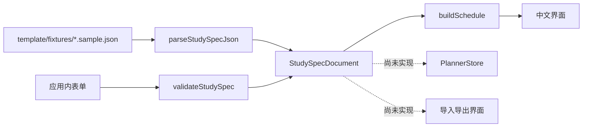

# 学生规划文档设计

准备日期：2026-11-09。本文接在 `requirements.md` 之后，并先于 `tasks.md`。

## 阶段 1 的实际边界

已经设计并且会在骨架里实现的部分：

- 共享文档类型、校验、规范 JSON、确定性排期。
- 两份带标记的示例数据。
- 两个独立的中文界面：展示示例、显示未排入工作、用表单把新事项放进本次页面状态。

只设计、不在阶段 1 实现的部分：

- 浏览器本地存储的真实读写。
- 文件选择、下载、拖放导入导出。
- 修改、删除、调整每日容量、把一条作业拆成多个子任务。
- 部署到 GitHub Pages。

未实现的存储函数必须返回 `not-implemented`。它不能假装保存成功。

## 组件



`app-homework` 与 `app-exam-review` 不共享 React 组件。它们都依赖 `@studyspec/core`。

## 文档模型

规范版本固定为 `1.0.0`。根对象只允许这些字段：

| 字段 | 含义 |
| --- | --- |
| schemaVersion | 必须是 `1.0.0` |
| kind | `homework` 或 `exam-review` |
| meta | 标题、是否示例、示例标签、锚点日期 |
| horizon | 含首尾的计划窗口 |
| capacity | 每日分钟上限，以及容量为 0 的日期 |
| items | 事项数组，输入顺序保留 |

事项字段：

| 字段 | 是否必须 | 说明 |
| --- | --- | --- |
| id | 必须 | 1 到 80 个字符，匹配 `^[a-z0-9][a-z0-9-]{0,79}$`，文档内唯一 |
| title | 必须 | 显示在日程里的名称 |
| estimatedMinutes | 必须 | 1 到 6000 的整数 |
| deadline | 必须 | 含当日的最后可排日期 |
| priority | 必须 | 1 到 9 的整数，1 最先 |
| course | 作业必须 | 复习文档可以不带 |
| subject | 复习必须 | 作业文档可以不带 |
| topic | 复习必须 | 作业文档可以不带 |
| notes | 可选 | 最多 2000 个字符，允许换行 |

其他限制：

- JSON 文本最多 1,000,000 个字符，拒绝 BOM。
- 事项最多 200 条。
- 窗口最多 366 天，开始日不得晚于结束日。
- 每日容量是 0 到 1440 的整数。0 表示窗口内没有可排容量。
- 不可用日期最多 366 个，必须唯一。解析后按日期升序保存。窗口外的不可用日期仍然保留，排期时只影响窗口内的同一天。
- 标题、课程、科目、主题和示例标签去掉首尾空白后不能为空，也不能含有控制字符。
- 不使用 Unicode 规范化。比较按校验后的码元进行。

`meta.anchorDate` 只给人和界面作参考。排期器不读它，也不读系统日期。

## 解析与序列化

`parseStudySpecJson(json: string)` 是导入接口的核心。它不读文件、不访问网络、不访问浏览器存储。

`validateStudySpec(input: unknown)` 接受未知值。成功时返回新的 `StudySpecDocument`。失败时返回全部已发现的问题，每一项包含 `path`、`code` 和中文 `message`。

`serializeStudySpec(input: unknown)` 是导出接口的核心。它先校验，成功时返回末尾带换行、两空格缩进的 JSON。字段顺序固定为上面的表格顺序。可选缺省字段不出现。失败时返回和解析器相同形状的错误，不抛出未捕获异常。

阶段 1 没有导入导出按钮。界面不调用序列化器；测试会调用它。

## 排期算法

输入是一份文档。函数先重新校验。窗口中的每一天都会出现在结果里，包括没有工作块的日子。

事项排序：

1. `deadline` 升序。
2. `priority` 升序。
3. `id` 升序。

对每个事项，从窗口开始日走到 `min(deadline, horizon.end)`：

- 跳过剩余容量为 0 的日期。
- 当天放入 `min(剩余容量, 事项剩余分钟)`。
- 放入量是整数。

如果事项在循环结束后仍有剩余分钟，追加一条未排入记录。原因按下面的顺序判断：

| 条件 | reason |
| --- | --- |
| 截止日期早于窗口开始日 | `deadline-before-horizon` |
| 截止日期前的窗口里没有容量大于 0 的日子 | `no-available-day` |
| 其他排不完的情况 | `insufficient-capacity` |

完全排完的事项不进入未排入列表。未排入记录的 `scheduledMinutes + unscheduledMinutes` 等于该事项的 `estimatedMinutes`。全部事项都满足这条等式。

结果还给出预计总分钟、已排总分钟和未排入总分钟。界面不得在未排入总分钟大于 0 时隐藏该区域。

## 日历实现

`template/src/dates.ts` 只用 `Date.UTC` 构造 UTC 时刻，再用 `getUTCFullYear`、`getUTCMonth`、`getUTCDate` 和 `getUTCDay` 读回公历字段。这是为了拒绝 `2026-02-29` 这种不存在的日期，不是为了读取“现在”。

星期标签由 UTC 星期几映射到固定中文。界面直接显示原始日期字符串加这个标签，不调用 `toLocaleDateString`。

## 浏览器存储设计

阶段 1 的 `createUnimplementedLocalStore()` 对任何键和文档都返回：

```json
{ "ok": false, "error": { "code": "not-implemented" } }
```

以后的实现才使用这些键：

- 作业救援：`studyspec.homework.v1`
- 复习计划：`studyspec.exam-review.v1`

以后的实现需要：

- 保存前再次校验，只写入 `serializeStudySpec` 的成功结果。
- 捕获浏览器容量错误和安全错误，映射到 `quota-exceeded` 与 `security-error`。
- 读出的文本先走 `parseStudySpecJson`。语法失败用 `corrupt-json`，结构失败用 `invalid-document`。
- 任何失败都返回结果对象，不把异常抛到 React 渲染之外。
- 存储里的 kind 与当前应用不一致时，不覆盖当前计划，并说明类型不匹配。此行为仍是后续任务。

## 应用壳

两个 Vite 应用各自拥有 `index.html`、入口、组件和样式。

作业救援：

- 端口 43123。
- 文案围绕课程、作业和截止日期。
- 日程用表格。
- 表单字段是课程、标题、截止日期、预计分钟和优先级。

复习计划：

- 端口 43124。
- 文案围绕科目、主题和考试日期。
- 日程用按日排列的卡片。
- 表单字段是科目、主题、标题、考试日期、预计分钟和优先级。

两边都要：

- `lang="zh-CN"`，控件有可见标签，错误使用 `role="alert"`。
- 示例横幅读取 `meta.sampleLabel`。
- 页面状态只存在内存。刷新回到示例是阶段 1 的真实行为，并在页面上说明。
- 新事项的 `id` 使用递增序号，例如 `hw-added-1`，不使用随机数或时钟。
- 页脚列出已经接上的行为和尚未实现的行为。

构建使用相对 `base`，方便以后放到静态目录。现在不配置 GitHub Pages，也不发布。

## 错误处理

| 场景 | 阶段 1 行为 |
| --- | --- |
| 示例 JSON 校验失败 | 页面显示错误，不渲染伪造日程 |
| 表单校验失败 | 保留原计划和新输入，显示核心返回的说明 |
| 排期函数收到坏文档 | 返回 `ok: false`，不生成部分日程 |
| 存储 | 固定返回 `not-implemented` |
| 未捕获异常 | 核心的公开解析、校验、序列化和未实现存储都不抛出业务错误 |

`serializeStudySpec` 在失败时返回错误对象。只有内部日期函数在程序员传入非法日期时抛出，公开排期入口会先校验。

## 测试策略

`template` 的单元测试覆盖：

- 公历日期、跨月加一天、星期标签。
- 两份示例都能通过校验，并且带示例标记。
- 坏 JSON、过大文本、未知字段、危险键、重复 id、非法日期、kind 专属字段。
- 序列化往返和两次序列化的文本一致。
- 示例排期的手算结果、分钟守恒、顺序变化不影响结果、截止日期早于窗口、整天不可用。
- 未实现存储的错误码。
- 生产源码不包含时钟、随机数和浏览器存储调用。

应用界面在阶段 1 不做组件测试。验收时启动构建产物，查看两份带示例标记的中文页面。

## 兼容性

两个应用的计划都是同一种 `StudySpecDocument`。作业文档可以被复习应用的解析器识别为合法 `homework` 文档；阶段 1 的复习页面不会提供跨应用导入按钮。以后的导入必须拒绝把另一种 kind 直接变成当前计划。共享往返指的是：同一解析器和序列化器不因应用不同而改变字段或排期。
